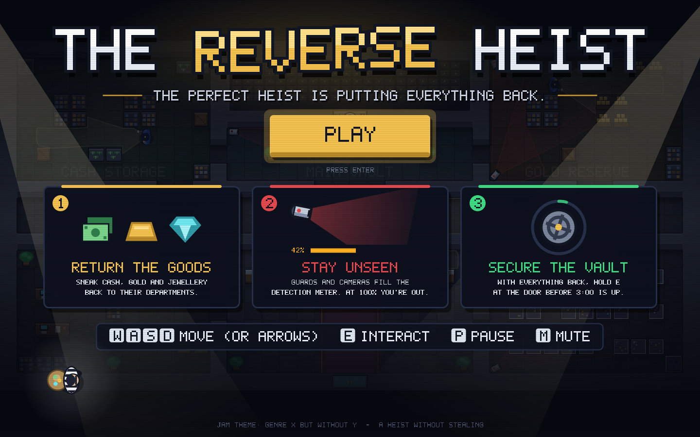
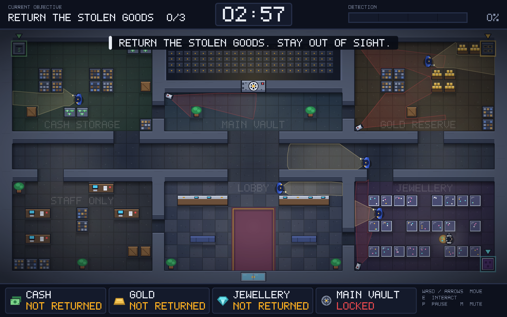
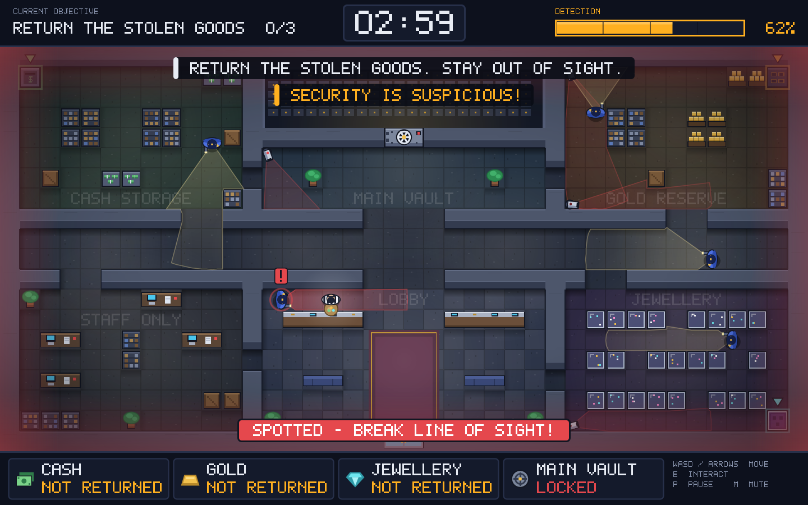
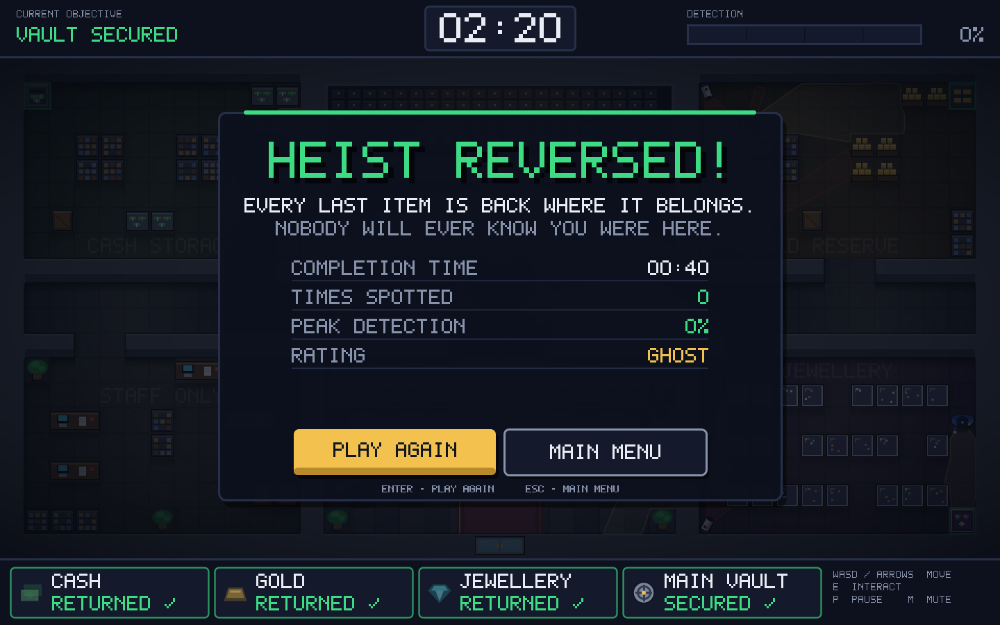

# The Reverse Heist

The Reverse Heist is a top-down stealth game developed in Java as a three-person team project.

The main brief was **"Genre X but without Y"**: take a recognisable game genre and remove one of the things normally associated with it. We chose a **heist game without stealing**. Instead, the player breaks into a bank carrying stolen cash, gold and jewellery and has to return each item to the correct area before securing the main vault.

**Java · Swing · Java2D**

## Screenshots

<p align="center">
  
  
</p>

<p align="center">
  
  
</p>

## How the game works

The player has three types of stolen goods to return: cash, gold and jewellery. Each item has its own return point inside the bank.

Once all three have been returned, the main vault can be secured to complete the heist. The player has to do this while avoiding guards and security cameras.

Guards and cameras have visible fields of view. Staying in sight increases the detection meter, while breaking line of sight allows it to fall again. Guards can move from patrol behaviour into suspicious and alerted states if they spot the player.

## Main features

- top-down stealth gameplay
- three return objectives plus the final vault objective
- guard patrols, detection and chase behaviour
- sweeping security cameras
- line-of-sight checks that interact with walls and furniture
- detection meter and caught state
- countdown timer
- scoring/end-screen statistics based on the run
- pause, mute and restart controls
- generated pixel-style graphics
- generated sound effects and music

## Technologies

The game is written in plain Java using Swing and Java2D. It does not use a game engine or third-party game library.

The visual assets, sound effects and music are generated by the program rather than loaded from external asset files.

## Team project

The Reverse Heist was developed by a team of three.

The project required us to combine gameplay rules, movement, stealth systems, rendering, input, audio and testing into one working Java application while following the "Genre X but without Y" constraint.

## Controls

| Key | Action |
| --- | --- |
| W A S D / Arrow keys | Move |
| E | Return goods / secure the vault |
| P / Esc | Pause |
| M | Mute |
| R | Restart from pause or end screens |
| Enter | Start / play again |

## Running the game

Java 8 or newer is required.

**Windows**

```text
run.bat
```

**macOS / Linux**

```bash
./run.sh
```

You can also run the packaged JAR directly:

```bash
java -jar dist/ReverseHeist.jar
```

## Building from source

A JDK is required.

**Windows**

```text
build.bat
```

**macOS / Linux**

```bash
./build.sh
```

Both scripts compile the Java source files and create `dist/ReverseHeist.jar`.

## Testing

The project includes automated headless tests for the main game logic. They cover areas including:

- map reachability and collisions
- guard and camera detection
- detection-meter behaviour
- timer and restart behaviour
- objective rules
- win and lose conditions
- a simulated full stealth play-through
- generated audio checks

Run them on macOS/Linux with:

```bash
./test.sh
```

The uploaded version passes the included automated test suite.

## Project structure

```text
src/heist/
  Main.java            Application entry point
  GamePanel.java       Input and game loop
  Game.java            Game rules and state
  Level.java           Map, collision, line of sight and path-finding
  Player.java          Player movement
  Guard.java           Guard patrol and detection behaviour
  SecurityCamera.java  Camera behaviour
  Station.java         Return points and vault objective
  Renderer.java        World, HUD and menu rendering
  Sprites.java         Pixel-style graphics generated in code
  PixelFont.java       Built-in pixel font
  Audio.java           Generated sound effects and music
  Palette.java         Colours
  Input.java           Keyboard and mouse state

test/heist/            Automated tests
itch/                   Cover image and screenshots
```

## Possible next steps

- add more levels or bank layouts
- add more guard behaviour and difficulty options
- improve the end-of-run scoring system
- add more gameplay feedback and polish
